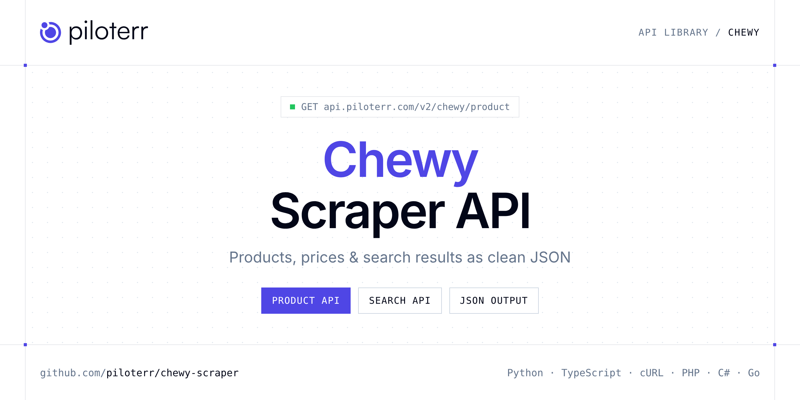

<p align="center">
  <a href="https://www.piloterr.com"></a>
</p>

# Chewy Scraper API

[](https://discord.gg/CFj3ph8aHU) [](https://app.piloterr.com) [](https://app.piloterr.com/openapi) [](LICENSE)

The **Piloterr Chewy Scraper API** lets you extract public data from Chewy as **clean, structured JSON** — no proxies, headless browsers or HTML parsing to maintain. Endpoints available in production:

- **Chewy Product API** — Retrieve full product details from a Chewy product page URL, including pricing, variants, ratings, and availability.
- **Chewy Search API** — Scrape Chewy search, brand, or category pages to retrieve a list of products with pricing, ratings, and availability.

Use it for price monitoring, assortment tracking, competitor analysis, product research or catalog enrichment.

| Endpoint | Path | Credits | What you get |
|---|---|---|---|
| [Chewy Product API](#chewy-product-api) | `/v2/chewy/product` | 2 | Retrieve full product details from a Chewy product page URL, including pricing, variants, ratings, and availability. |
| [Chewy Search API](#chewy-search-api) | `/v2/chewy/search` | 2 | Scrape Chewy search, brand, or category pages to retrieve a list of products with pricing, ratings, and availability. |

## Table of contents

- [How it works](#how-it-works)
- [Chewy Product API](#chewy-product-api)
- [Chewy Search API](#chewy-search-api)
- [Code examples in other languages](#code-examples-in-other-languages)
- [Practical use cases](#practical-use-cases)
- [Why Piloterr?](#why-piloterr)
- [FAQ](#faq)
- [Related scrapers](#related-scrapers)
- [Support](#support)

## How it works

1. **Create a free Piloterr account** and copy your API key from the [dashboard](https://app.piloterr.com).
2. **Send a `GET` (or `POST`) request** to `https://api.piloterr.com/v2/...` with the header `x-api-key: YOUR_API_KEY`.
3. **Receive structured JSON** — Piloterr handles rendering, proxies, retries and parsing.

```bash
export PILOTERR_API_KEY="your-api-key"
pip install requests        # Python
# TypeScript: Node.js 18+ (native fetch), run with `npx tsx file.ts`
```

> Every endpoint accepts both `GET` (query string) and `POST` (JSON body with the same fields).

## Chewy Product API

Retrieve full product details from a Chewy product page URL, including pricing, variants, ratings, and availability.

`GET | POST https://api.piloterr.com/v2/chewy/product` · **2 credits per request** · [Full reference](https://app.piloterr.com/openapi)

### Request parameters

| Parameter | Type | Required | Description |
|---|---|---|---|
| `query` | string | ✅ | Chewy product page URL to scrape. |

### Python example

```python
import json
import os
import requests

response = requests.get(
    "https://api.piloterr.com/v2/chewy/product",
    headers={"x-api-key": os.environ["PILOTERR_API_KEY"]},
    params={
        "query": "https://www.chewy.com/dp/371150",
    },
    timeout=60,
)
response.raise_for_status()
data = response.json()

print(json.dumps(data, indent=2, ensure_ascii=False)[:2000])
```

### TypeScript example

```typescript
type ChewyProduct = {
  ROOT_QUERY?: {
    pdp?: {
      __typename?: string;
      featureToggles?: Record<string, unknown>;
    };
    __typename?: string;
    currentUser?: unknown;
    "item({\"id\":\"371150\"})"?: {
      __ref?: string;
    };
    "product({\"id\":\"371138\"})"?: {
      __ref?: string;
    };
  };
  "Item:SXRlbTozNzExNTA="?: {
    id?: string;
    gtin?: string;
    name?: string;
    entryID?: string;
    inStock?: boolean;
    isFresh?: boolean;
    isBundle?: boolean;
    isFrozen?: boolean;
    mapPrice?: string;
    isInStock?: boolean;
    isVetDiet?: boolean;
    onSpecial?: boolean;
    __typename?: string;
    dimensions?: string;
    isGiftCard?: boolean;
    isLiveFeed?: boolean;
    partNumber?: string;
    description?: string;
    isPublished?: boolean;
    keyBenefits?: string[];
    perUnitPrice?: string;
    autoshipPrice?: string;
    isUnavailable?: boolean;
    isPrescription?: boolean;
    advertisedPrice?: string;
    [key: string]: unknown;
  };
  "Product:UHJvZHVjdDozNzExMzg="?: {
    id?: string;
    name?: string;
    slug?: string;
    rating?: number;
    entryID?: string;
    __typename?: string;
    isEnsemble?: boolean;
    partNumber?: string;
    description?: string;
    ratingCount?: number;
    manufacturerName?: string;
  };
};

const params = new URLSearchParams({
  "query": "https://www.chewy.com/dp/371150",
});

const response = await fetch(`https://api.piloterr.com/v2/chewy/product?${params}`, {
  headers: { "x-api-key": process.env.PILOTERR_API_KEY! },
});
if (!response.ok) throw new Error(`Piloterr error ${response.status}: ${await response.text()}`);

const data = (await response.json()) as ChewyProduct;

console.log(JSON.stringify(data, null, 2).slice(0, 2000));
```

<details>
<summary><b>POST variant</b></summary>

```http
POST https://api.piloterr.com/v2/chewy/product
x-api-key: YOUR_API_KEY
Content-Type: application/json

{"query": "https://www.chewy.com/dp/371150"}
```
</details>

### Output example

Example response from the API reference, abridged — real values depend on the page you scrape.

```json
{
  "ROOT_QUERY": {
    "pdp": {
      "__typename": "PDP",
      "featureToggles": {
        "__typename": "PDPFeatureToggles",
        "qnaEnabled": true,
        "reviewsEnabled": true,
        "fbtWidgetEnabled": true,
        "realTimeDealsEnabled": true,
        "loyaltyFeaturesEnabled": true
      }
    },
    "__typename": "Query",
    "currentUser": null,
    "item({\"id\":\"371150\"})": {
      "__ref": "Item:SXRlbTozNzExNTA="
    },
    "product({\"id\":\"371138\"})": {
      "__ref": "Product:UHJvZHVjdDozNzExMzg="
    }
  },
  "Item:SXRlbTozNzExNTA=": {
    "id": "SXRlbTozNzExNTA=",
    "gtin": "672288001200",
    "name": "Green Lifestyle Printed Reusable Cat & Dog Pee Pads, Blue & White, 41 x 41-in, 2 count",
    "entryID": "371150",
    "inStock": true,
    "isFresh": false,
    "isBundle": false,
    "isFrozen": false,
    "mapPrice": "$34.99",
    "isInStock": true,
    "isVetDiet": false,
    "onSpecial": true,
    "__typename": "Item",
    "dimensions": "41 x 41 x 0.3 inches",
    "isGiftCard": false,
    "isLiveFeed": false,
    "partNumber": "344914",
    "description": "Protect your home from a variety of pet messes with Green Lifestyle Printed Reusable Pee Pads for Cat & Dog.",
    "isPublished": true,
    "keyBenefits": [
      "Large, thick pads are ideal for a variety of pets, including pups, feline friends and bunnies.",
      "Waterproof backing locks in moisture to prevent messy leaks."
    ],
    "perUnitPrice": "$17.50",
    "autoshipPrice": "$33.24",
    "isUnavailable": false,
    "isPrescription": false,
    "advertisedPrice": "$34.99"
  },
  "Product:UHJvZHVjdDozNzExMzg=": {
    "id": "UHJvZHVjdDozNzExMzg=",
    "name": "Green Lifestyle Printed Reusable Cat & Dog Pee Pads, Blue & White",
    "slug": "green-lifestyle-printed-reusable-cat",
    "rating": 4.6938,
    "entryID": "371138",
    "__typename": "Product",
    "isEnsemble": false,
    "partNumber": "344902",
    "description": "Protect your home from a variety of pet messes with Green Lifestyle Printed Reusable Pee Pads for Cat & Dog.",
    "ratingCount": 369,
    "manufacturerName": "Green Lifestyle"
  }
}
```

### Response fields

| Field | Type | Description |
|---|---|---|
| `ROOT_QUERY` | object |  |
| `ROOT_QUERY.pdp` | object |  |
| `ROOT_QUERY.__typename` | string |  |
| `ROOT_QUERY.currentUser` | object |  |
| `ROOT_QUERY.item({"id":"371150"})` | object |  |
| `ROOT_QUERY.product({"id":"371138"})` | object |  |
| `Item:SXRlbTozNzExNTA=` | object |  |
| `Item:SXRlbTozNzExNTA=.id` | string |  |
| `Item:SXRlbTozNzExNTA=.gtin` | string |  |
| `Item:SXRlbTozNzExNTA=.name` | string |  |
| `Item:SXRlbTozNzExNTA=.entryID` | string |  |
| `Item:SXRlbTozNzExNTA=.inStock` | boolean |  |
| `Item:SXRlbTozNzExNTA=.isFresh` | boolean |  |
| `Item:SXRlbTozNzExNTA=.isBundle` | boolean |  |
| `Item:SXRlbTozNzExNTA=.isFrozen` | boolean |  |
| `Item:SXRlbTozNzExNTA=.mapPrice` | string |  |
| `Item:SXRlbTozNzExNTA=.isInStock` | boolean |  |
| `Item:SXRlbTozNzExNTA=.isVetDiet` | boolean |  |
| `Item:SXRlbTozNzExNTA=.onSpecial` | boolean |  |
| `Item:SXRlbTozNzExNTA=.__typename` | string |  |
| `Item:SXRlbTozNzExNTA=.dimensions` | string |  |
| `Item:SXRlbTozNzExNTA=.isGiftCard` | boolean |  |
| `Item:SXRlbTozNzExNTA=.isLiveFeed` | boolean |  |
| `Item:SXRlbTozNzExNTA=.partNumber` | string |  |
| `Item:SXRlbTozNzExNTA=.description` | string |  |

## Chewy Search API

Scrape Chewy search, brand, or category pages to retrieve a list of products with pricing, ratings, and availability.

`GET | POST https://api.piloterr.com/v2/chewy/search` · **2 credits per request** · [Full reference](https://app.piloterr.com/openapi)

### Request parameters

| Parameter | Type | Required | Description |
|---|---|---|---|
| `query` | string | ✅ | Chewy search or browse URL to scrape results from. |

### Python example

```python
import json
import os
import requests

response = requests.get(
    "https://api.piloterr.com/v2/chewy/search",
    headers={"x-api-key": os.environ["PILOTERR_API_KEY"]},
    params={
        "query": "https://www.chewy.com/brands/feliway-6614",
    },
    timeout=60,
)
response.raise_for_status()
data = response.json()

print(json.dumps(data, indent=2, ensure_ascii=False)[:2000])
```

### TypeScript example

```typescript
type ChewySearch = {
  results?: {
    ppu?: string;
    href?: string;
    name?: string;
    image?: string;
    is_ad?: boolean;
    is_atf?: boolean;
    is_new?: boolean;
    rating?: number;
    is_deal?: boolean;
    in_stock?: boolean;
    is_fresh?: boolean;
    is_bundle?: boolean;
    is_frozen?: boolean;
    description?: string;
    part_number?: string;
    manufacturer?: string;
    rating_count?: number;
    strike_price?: string;
    display_price?: string;
    autoship_price?: string;
    is_rx_vet_diet?: boolean;
    is_discontinued?: boolean;
    is_prescription?: boolean;
  }[];
};

const params = new URLSearchParams({
  "query": "https://www.chewy.com/brands/feliway-6614",
});

const response = await fetch(`https://api.piloterr.com/v2/chewy/search?${params}`, {
  headers: { "x-api-key": process.env.PILOTERR_API_KEY! },
});
if (!response.ok) throw new Error(`Piloterr error ${response.status}: ${await response.text()}`);

const data = (await response.json()) as ChewySearch;

console.log(JSON.stringify(data, null, 2).slice(0, 2000));
```

<details>
<summary><b>POST variant</b></summary>

```http
POST https://api.piloterr.com/v2/chewy/search
x-api-key: YOUR_API_KEY
Content-Type: application/json

{"query": "https://www.chewy.com/brands/feliway-6614"}
```
</details>

### Output example

Example response from the API reference, abridged — real values depend on the page you scrape.

```json
{
  "results": [
    {
      "ppu": "$24.99/ea",
      "href": "https://www.chewy.com/feliway-multicat-30-day-starter-kit/dp/116881",
      "name": "Feliway MultiCat 30 Day Starter Kit Calming Diffuser for Cats, 1 count",
      "image": "https://image.chewy.com/catalog/general/images/feliway-multicat-30-day-starter-kit-calming-diffuser-for-cats-1-count/img-740068,1",
      "is_ad": false,
      "is_atf": false,
      "is_new": false,
      "rating": 3.711,
      "is_deal": true,
      "in_stock": true,
      "is_fresh": false,
      "is_bundle": false,
      "is_frozen": false,
      "description": "After cats give birth, they naturally produce pheromones that send harmony messages to their little ones. Feliway MultiCat 30 Day Starter…",
      "part_number": "94199",
      "manufacturer": "Feliway",
      "rating_count": 3246,
      "strike_price": "$33.99",
      "display_price": "$24.99",
      "autoship_price": "$23.74",
      "is_rx_vet_diet": false,
      "is_discontinued": false,
      "is_prescription": false
    },
    {
      "ppu": "$24.99/ea",
      "href": "https://www.chewy.com/feliway-multicat-calming-diffuser-refill/dp/52450",
      "name": "Feliway MultiCat Calming Diffuser Refill for Cats, 1 count",
      "image": "https://image.chewy.com/catalog/general/images/feliway-multicat-calming-diffuser-refill-for-cats-1-count/img-627449,1",
      "is_ad": false,
      "is_atf": false,
      "is_new": false,
      "rating": 3.914,
      "is_deal": false,
      "in_stock": true,
      "is_fresh": false,
      "is_bundle": false,
      "is_frozen": false,
      "description": "Help create harmony and avoid conflict between your cats with Feliway MultiCat Calming Diffuser Refill.",
      "part_number": "52450",
      "manufacturer": "Feliway",
      "rating_count": 1842,
      "strike_price": null,
      "display_price": "$24.99",
      "autoship_price": "$23.74",
      "is_rx_vet_diet": false,
      "is_discontinued": false,
      "is_prescription": false
    }
  ]
}
```

### Response fields

| Field | Type | Description |
|---|---|---|
| `results[]` | object[] |  |
| `results[].ppu` | string |  |
| `results[].href` | string |  |
| `results[].name` | string |  |
| `results[].image` | string |  |
| `results[].is_ad` | boolean |  |
| `results[].is_atf` | boolean |  |
| `results[].is_new` | boolean |  |
| `results[].rating` | number |  |
| `results[].is_deal` | boolean |  |
| `results[].in_stock` | boolean |  |
| `results[].is_fresh` | boolean |  |
| `results[].is_bundle` | boolean |  |
| `results[].is_frozen` | boolean |  |
| `results[].description` | string |  |
| `results[].part_number` | string |  |
| `results[].manufacturer` | string |  |
| `results[].rating_count` | integer |  |
| `results[].strike_price` | string |  |
| `results[].display_price` | string |  |
| `results[].autoship_price` | string |  |
| `results[].is_rx_vet_diet` | boolean |  |
| `results[].is_discontinued` | boolean |  |
| `results[].is_prescription` | boolean |  |

## Code examples in other languages

Ready-to-run examples live in the [`examples/`](examples) folder. Each one reads your key from the `PILOTERR_API_KEY` environment variable.

| Language | Product | Search |
|---|---|---|
| cURL (Bash) | [`product`](examples/curl/product.sh) | [`search`](examples/curl/search.sh) |
| PHP | [`product`](examples/php/product.php) | [`search`](examples/php/search.php) |
| C# | [`product`](examples/csharp/Product.cs) | [`search`](examples/csharp/Search.cs) |
| Go | [`product`](examples/go/product.go) | [`search`](examples/go/search.go) |
| Java | [`product`](examples/java/ProductExample.java) | [`search`](examples/java/SearchExample.java) |
| Ruby | [`product`](examples/ruby/product.rb) | [`search`](examples/ruby/search.rb) |
| Node.js | [`product`](examples/nodejs/product.mjs) | [`search`](examples/nodejs/search.mjs) |

## Practical use cases

- **Price monitoring** — Track prices, promotions and availability over time to react to competitors.
- **Assortment & catalog tracking** — Follow new products, delisted items and category changes.
- **Competitor analysis** — Benchmark ranges, brands and positioning across retailers.
- **Product research** — Spot best-sellers and trends from search results.
- **Catalog enrichment** — Pull titles, images and attributes into your PIM or marketplace listings.

## Why Piloterr?

- **No infrastructure** — no proxies, headless browsers or CAPTCHA solving to run yourself.
- **Structured JSON** — stable, documented fields instead of brittle HTML selectors.
- **Pay per request** — transparent credit cost per endpoint, failed requests are retried for you.
- **One API key, hundreds of sources** — Chewy plus many other e-commerce, search and company data endpoints in the [Piloterr library](https://www.piloterr.com/library).
- **Any language** — plain HTTPS + JSON, with examples for Python, TypeScript, cURL, PHP, C#, Go, Java, Ruby and Node.js.

## FAQ

### Is it legal to scrape Chewy?

Collecting publicly available data is generally allowed in many jurisdictions, but rules depend on your country, the data you collect and how you use it. Avoid personal data unless you have a lawful basis, respect the website's terms where they apply, and get legal advice for your specific use case. This is not legal advice.

### Do I need proxies or a headless browser?

No. Piloterr handles rendering, proxy rotation and retries on its side. You only send an HTTPS request with your `x-api-key` header and receive JSON.

### How much does a request cost?

Credits per call: `/v2/chewy/product` **2**, `/v2/chewy/search` **2**. See the [Piloterr website](https://www.piloterr.com) for plans.

### What data does the Chewy API return?

Each endpoint returns structured JSON: **Chewy Product** — `ROOT_QUERY`, `ROOT_QUERY.pdp`, `ROOT_QUERY.__typename`, `ROOT_QUERY.currentUser`, `ROOT_QUERY.item({"id":"371150"})`, `ROOT_QUERY.product({"id":"371138"})`; **Chewy Search** — `results[]`, `results[].ppu`, `results[].href`, `results[].name`, `results[].image`, `results[].is_ad`.

### Which languages are supported?

Any language that can make an HTTP request. This README shows Python and TypeScript; the [`examples/`](examples) folder contains cURL, PHP, C#, Go, Java, Ruby and Node.js.

## Related scrapers

- [About You Scraper API](https://github.com/piloterr/aboutyou-scraper)
- [Action Scraper API](https://github.com/piloterr/action-scraper)
- [Aldi Scraper API](https://github.com/piloterr/aldi-scraper)
- [Alibaba Scraper API](https://github.com/piloterr/alibaba-scraper)
- [AliExpress Scraper API](https://github.com/piloterr/aliexpress-scraper)
- [Allegro Scraper API](https://github.com/piloterr/allegro-scraper)
- [All Piloterr scrapers on GitHub](https://github.com/piloterr)

## Support

- 💬 Join the [Piloterr Discord](https://discord.gg/CFj3ph8aHU) to ask questions and share what you build.
- 📚 Browse the [API reference (OpenAPI)](https://app.piloterr.com/openapi) and the [Piloterr library](https://www.piloterr.com/library).
- 🔑 [Get your API key](https://app.piloterr.com).

---

<p align="center">
  <a href="https://www.piloterr.com">
    <picture>
      <source media="(prefers-color-scheme: dark)" srcset="images/logo-dark.svg">
      
    </picture>
  </a>
  <br>
  <sub>Built by <a href="https://www.piloterr.com">Piloterr</a> — web scraping APIs for e-commerce, search, real estate and more, one API key.</sub>
</p>

<sub>Chewy is a trademark of its respective owner. This repository is not affiliated with or endorsed by Chewy. Examples are released under the MIT license.</sub>
